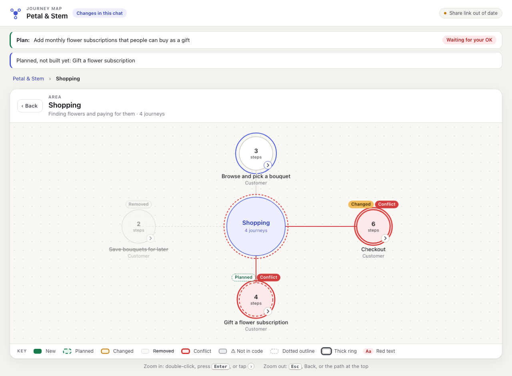
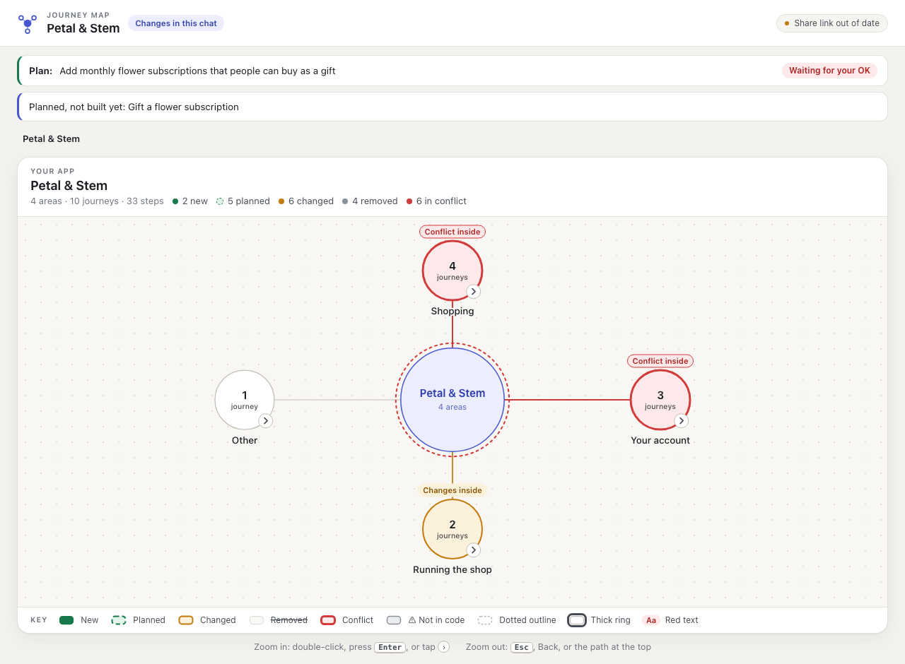
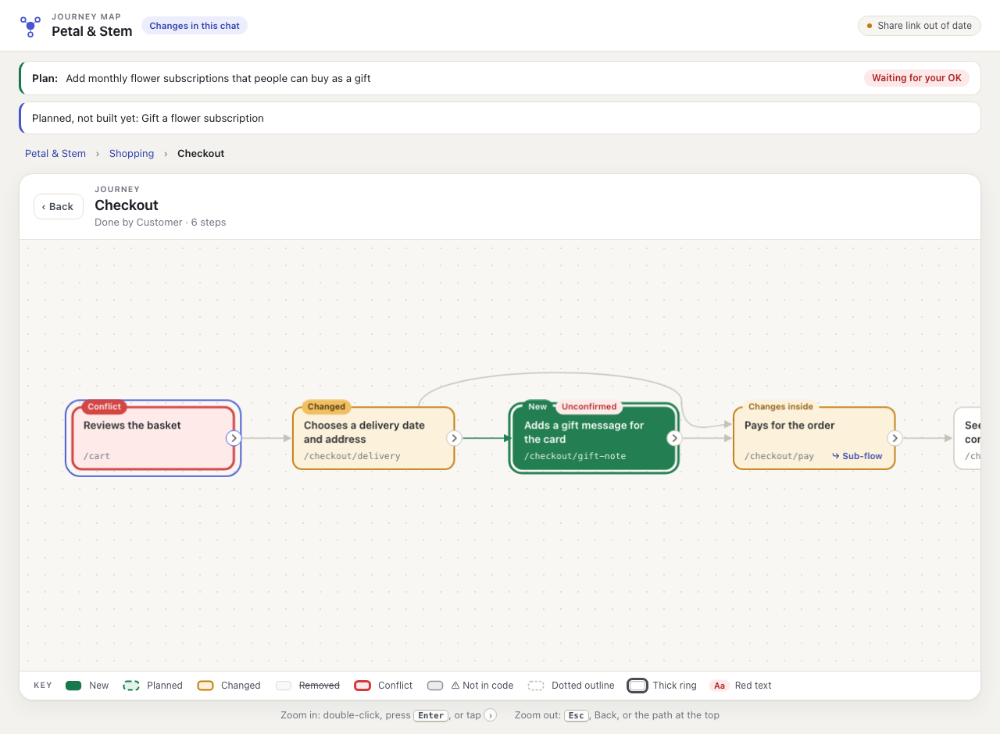

# journeymap

**See what your AI is building, before and after it builds it.**

journeymap gives your app a living map: every user journey, from the whole product down to a single step, kept up to date by your coding agent as it works. You don't need to read code to know what exists, what's about to change, and what just broke.



## What people use it for

**Understand what your agent is proposing, and the trade-offs.**
Before Claude builds anything you'd notice, it draws the change on the map:
- New journeys show dashed.
- Journeys that will change show amber.
- Clashes with existing flows show red.

You approve a picture you understand, not a diff you don't.

**Stop features being built on top of each other.**
If a change would rewire a screen another journey depends on, for example a new booking flow reusing the checkout page, journeymap catches it *before* any code is written. Claude Code then asks you to allow it.

**Test UX flows and QA every change.**
- **Test paths.** Every journey is a ready-made test path. Click through it step by step: what the user sees, what they do, the rules, the data saved.
- **What to retest.** Anything this chat changed stays highlighted, so you know exactly what to retest.
- **Broken steps.** Steps whose page disappeared are flagged.

**See your whole product at a glance, then zoom all the way in.**
- **Zoom levels:** your app → its areas → each journey → each step → any step's own sub-flow.
- **Who it's for:** founders, PMs, designers and new teammates, without opening a code editor.

**Catch drift and dead ends.**
- **Unmapped pages.** A new page that nobody put on the map shows up as "Unmapped changes".
- **Missing pages.** A link to a page that doesn't exist shows up as broken.
- **Matches the code.** The map stays honest, because every step is tied to real code.

**Keep stakeholders in the loop.**
The map publishes to a private link that updates itself as you build. Share it with a co-founder or client instead of writing a status update.

**Keep your agent strategic.**
Plans are framed as user goals ("Customer books a call"), not files. That keeps the agent, and you, focused on what the product does.

<table>
<tr>
<td></td>
<td></td>
</tr>
<tr>
<td align="center">Your whole app at a glance</td>
<td align="center">One journey, step by step</td>
</tr>
</table>

## Install

```bash
claude plugin marketplace add bmoski8/journeymap && claude plugin install journeymap@journeymap
```

Or from inside Claude Code:

```
/plugin marketplace add bmoski8/journeymap
/plugin install journeymap@journeymap
```

Then open your project in Claude Code and run:

```
/journeymap:map-app
```

Claude surveys your app, draws the first map and asks you to correct anything that's wrong. From then on the map keeps itself up to date while you build.

**Needs:** Claude Code and Node.js 20+ ([nodejs.org](https://nodejs.org)).

## How it works

```
you ask for a change ─► Claude draws the plan on the map ─► you see the proposal (ghost overlay)
                                                      │
                      clashes with an existing journey? ─► Claude Code asks you before any edit
                                                      ▼
                          Claude builds ─► end of turn: map checked against the code, redrawn, republished
```

- **`.journeys/journeys.json`** is the map's data: areas, journeys and steps, each tied to a file or route. Claude writes it in plain language; you never have to.
- **`journeys.html`** is a clean, self-contained copy of the map, committed with your code. It opens offline and makes no external requests.
- **`.journeys/.session/`** (gitignored) holds each chat's live view with its change colours and proposals. Parallel chats don't collide.

**Light on your session**
- About 120 tokens of always-on context.
- The four hooks are plain Node: no AI calls and no network.
- They take about 0.1s even on a 50,000-file repo.
- They never block a turn more than once, and they never break your session.

### Settings

`.journeys/config.json` (committed):

| Key | Default | What it does |
|---|---|---|
| `shared` | `["/", "/dashboard"]` | Screens every journey passes through. Adding a step there isn't treated as a clash. |
| `routeDirs` | `app`, `pages`, `src/app`, `src/pages`, `src/routes` | Where file-based routes live (Next.js style). |
| `sourceGlobs` | `src/**`, `app/**`, `pages/**` | Where to look for route definitions (React Router, Vite and others). |
| `ignore` | tests, docs, lockfiles… | Files that never count as flow changes. |

Environment variable `JOURNEYMAP_GATE`:
- `on` (default): ask before risky edits.
- `warn`: build anyway, and mark the change "built without approval" on the map.
- `off`: no gate. Use `warn` or `off` for headless and CI runs, where nobody can answer a prompt.

## Status

Early (v0.1), and Claude Code only for now. Route checking understands Next.js file routes and `path:` / `<Route path>` definitions. Other frameworks show as "unverified" rather than wrong. See [TODOS.md](TODOS.md) for what's next, and [docs/architecture.md](docs/architecture.md) for how it fits together.

## Contributing

Small, focused pull requests are welcome. See [CONTRIBUTING.md](CONTRIBUTING.md). Report security issues privately: [SECURITY.md](SECURITY.md).

MIT licensed.
