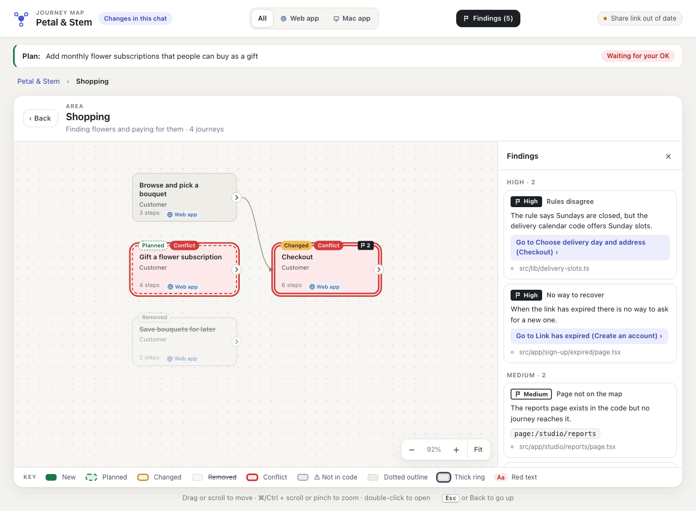
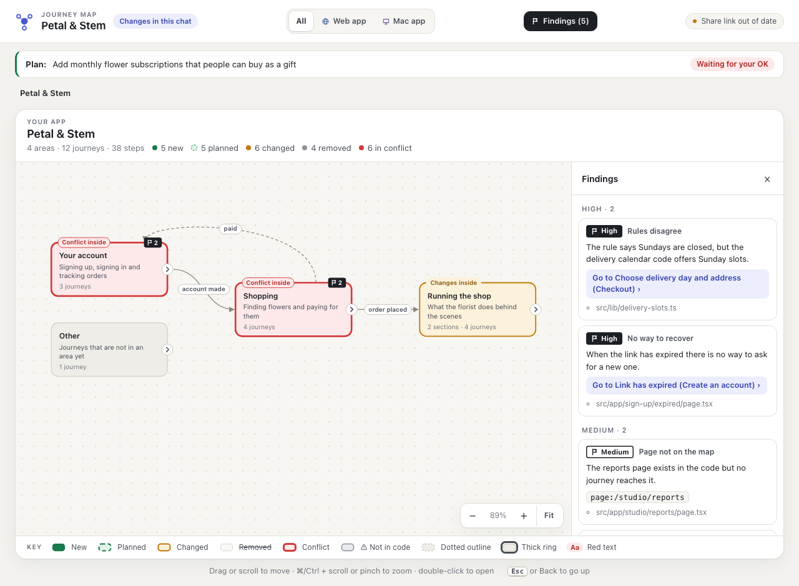
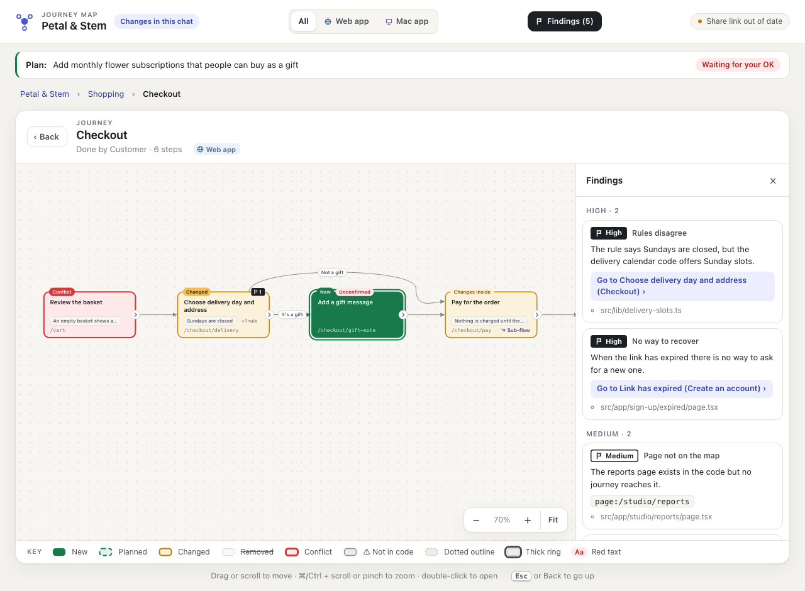

# Chef's Table

*A [Soffritto Technologies](https://github.com/Soffritto-Technologies) project.*

**See what your AI is building, before and after it builds it.**

Chef's Table gives your app a living map: every user journey, from the whole product down to a single step, kept up to date by your coding agent as it works. You don't need to read code to know what exists, what's about to change, and what just broke.



## What people use it for

**Understand what your agent is proposing, and the trade-offs.**
Before Claude builds anything you'd notice, it draws the change on the map:
- New journeys show dashed.
- Journeys that will change show amber.
- Clashes with existing flows show red.

You approve a picture you understand, not a diff you don't.

**Stop features being built on top of each other.**
If a change would rewire a screen another journey depends on, for example a new booking flow reusing the checkout page, Chef's Table catches it *before* any code is written. Claude Code then asks you to allow it.

**Test UX flows and QA every change.**
- **Test paths.** Every journey is a ready-made test path. Click through it step by step: what the user sees, what they do, the rules, the data saved.
- **What to retest.** Anything this chat changed stays highlighted, so you know exactly what to retest.
- **Broken steps.** Steps whose page disappeared are flagged.

**See your whole product at a glance, then zoom all the way in.**
- **Zoom levels:** your app → its areas → each journey → each step → any step's own sub-flow.
- **A flow at every level, never a mind map:** the whole app reads in the order a person meets it, each area as the order of its journeys, each journey as its steps. Double-click any box to open its own flow.
- **Who it's for:** founders, PMs, designers and new teammates, without opening a code editor.

**Catch drift and dead ends.**
- **Unmapped pages.** A new page that nobody put on the map shows up as "Unmapped changes".
- **Missing pages.** A link to a page that doesn't exist shows up as broken.
- **Matches the code.** The map stays honest, because every step is tied to real code.

**Keep stakeholders in the loop.**
The map publishes to a private link that updates itself as you build. Share it with a co-founder or client instead of writing a status update.

**Keep your agent strategic.**
Plans are framed as user goals ("Customer books a call"), not files. That keeps the agent, and you, focused on what the product does.

<table>
<tr>
<td></td>
<td></td>
</tr>
<tr>
<td align="center">Your whole app at a glance</td>
<td align="center">One journey, step by step</td>
</tr>
</table>

## Install

Run these two commands yourself, in a terminal:

```bash
claude plugin marketplace add Soffritto-Technologies/chefs-table
claude plugin install chefs-table@chefs-table
```

Or type them into the Claude Code prompt:

```
/plugin marketplace add Soffritto-Technologies/chefs-table
/plugin install chefs-table@chefs-table
```

> **Install it yourself, not by asking Claude.** If you ask Claude to install it while auto mode is on, auto mode stops the install with "Untrusted Code Integration". That's auto mode working as intended: a plugin runs code on your machine, so a person should be the one who chooses to install it. When you run the commands yourself, that check never comes up.

Then start a new Claude Code chat in your project and run:

```
/chefs-table:map-app
```

Claude surveys your app, draws the first map and asks you to correct anything that's wrong. From then on the map keeps itself up to date while you build.

Already have a map from an earlier version? `/chefs-table:order` adds the order between areas and journeys with one small, cheap helper. It reads titles only, not your code.

**Needs:** Claude Code and Node.js 20+ ([nodejs.org](https://nodejs.org)).

## How it works

```
you ask for a change ─► Claude draws the plan on the map ─► you see the proposal (ghost overlay)
                                                      │
                      clashes with an existing journey? ─► Claude Code asks you before any edit
                                                      ▼
                          Claude builds ─► end of turn: map checked against the code, redrawn, republished
```

- **`.journeys/journeys.json`** is the map's data: areas, journeys and steps, each tied to a file or route. Claude writes it in plain language; you never have to.
- **`journeys.html`** is a clean, self-contained copy of the map, committed with your code. It opens offline and makes no external requests.
- **`.journeys/.session/`** (gitignored) holds each chat's live view with its change colours and proposals. Parallel chats don't collide.

**Light on your session**
- About 120 tokens of always-on context.
- The five hooks are plain Node: no AI calls and no network.
- They take about 0.1s even on a 50,000-file repo.
- They never block a turn more than once, and they never break your session.

### Settings

`.journeys/config.json` (committed):

| Key | Default | What it does |
|---|---|---|
| `shared` | `["/", "/dashboard"]` | Screens every journey passes through. Adding a step there isn't treated as a clash. |
| `routeDirs` | `app`, `pages`, `src/app`, `src/pages`, `src/routes` | Where file-based routes live (Next.js style). |
| `sourceGlobs` | `src/**`, `app/**`, `pages/**` | Where to look for route definitions (React Router, Vite and others). |
| `ignore` | tests, docs, lockfiles… | Files that never count as flow changes. |

Environment variable `CHEFS_TABLE_GATE`:
- `on` (default): ask before risky edits.
- `warn`: build anyway, and mark the change "built without approval" on the map.
- `off`: no gate. Use `warn` or `off` for headless and CI runs, where nobody can answer a prompt.

## What it runs on your machine

A plugin is code that runs on your computer, so here is exactly what this one does:

- **Hooks:** small Node scripts run when a chat starts, around each file edit, when a helper finishes and at the end of each turn. They read your project's files. They write only to `.journeys/` and `journeys.html`, and `init` adds four lines to `.gitignore`.
- **No network, no packages, no shell commands:** zero dependencies. The hooks never contact the internet, never start other programs and never call an AI.
- **Map text is treated as data:** whatever the hooks pass to Claude from the map is cleaned, capped in length and labelled as data, so a booby-trapped `journeys.json` in someone else's repo can't slip instructions to Claude.
- **Your map stays yours:** Claude publishes the live map as a private claude.ai Artifact, which only you see until you share it. `journeys.json` and `journeys.html` describe your app's flows and are committed with your code, so in a public repo they're public too.
- **Usage:** `/chefs-table:map-app` uses helper agents, which spends your Claude usage. It stops at the budget you give it.
- **Updates:** installing or updating pulls the latest `main` from this repo. To audit what you run, read `hooks/hooks.json` and `bin/`.

## Status

Early (v0.1), and Claude Code only for now. Route checking understands Next.js file routes and `path:` / `<Route path>` definitions. Other frameworks show as "unverified" rather than wrong. See [TODOS.md](TODOS.md) for what's next, and [docs/architecture.md](docs/architecture.md) for how it fits together.

## Contributing

Small, focused pull requests are welcome. See [CONTRIBUTING.md](CONTRIBUTING.md). Report security issues privately: [SECURITY.md](SECURITY.md).

MIT licensed.
